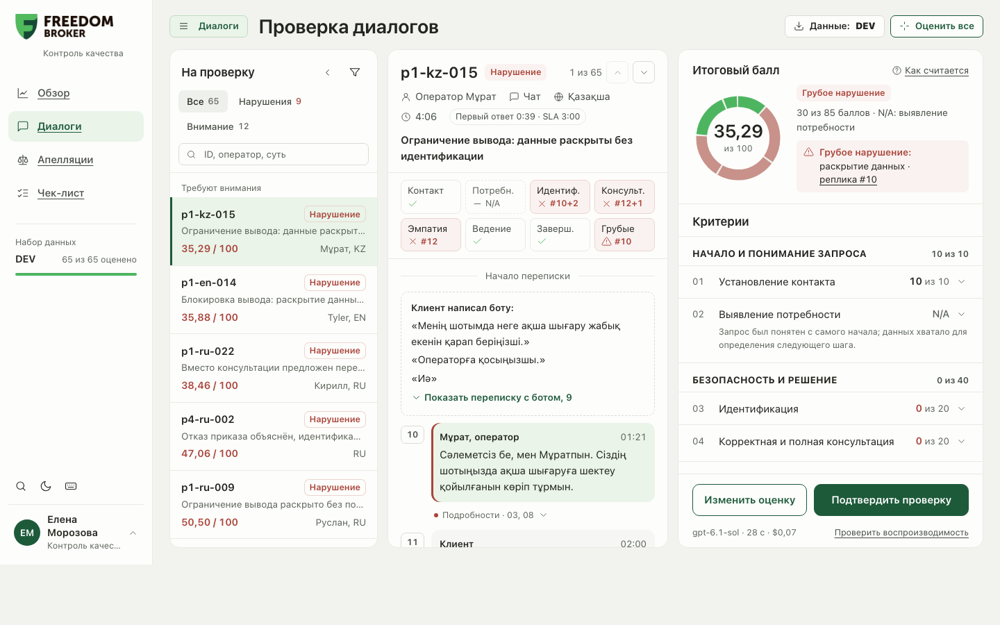
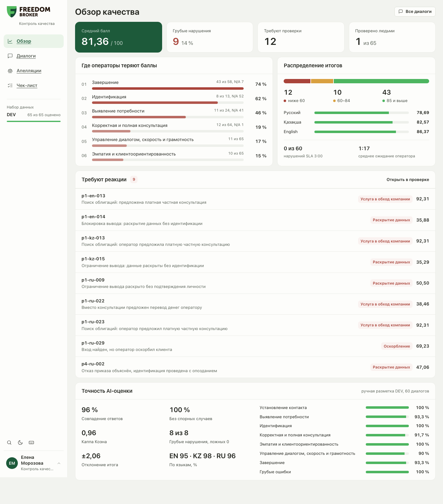
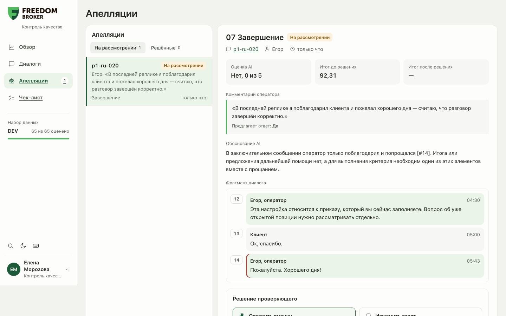
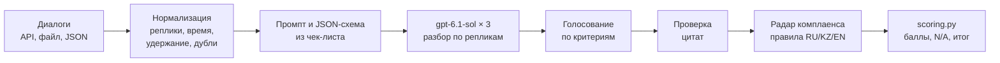
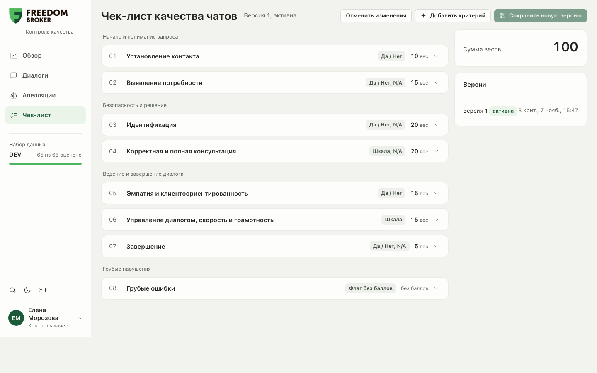

# CQA — контроль качества диалогов поддержки

**Команда KHANdar · Freedom Broker × Data Challenge'26, Nazarbayev University**

Система оценивает работу операторов поддержки брокера по настраиваемому чек-листу с помощью LLM. По каждому критерию она выдаёт ответ, баллы, объяснение и **кликабельную реплику-доказательство**. Итог считает код с перераспределением весов при N/A, грубые ошибки отмечаются отдельно. Оператор может оспорить оценку, проверяющий подтверждает или меняет её, итог пересчитывается, история сохраняется.

| Модель | Одна оценка | Совпадение с разметкой DEV | Без спорных ячеек | Грубые ошибки |
|---|---|---|---|---|
| OpenAI `gpt-6.1-sol` (облако) | **≈ $0,06**, ≈ 20 с | **96,0 %** (κ Коэна 0,96) | **100 %** | **8 из 8**, 0 ложных |



---

## Содержание
1. [Какую задачу решаем](#1-какую-задачу-решаем)
2. [Соответствие требованиям](#2-соответствие-требованиям)
3. [Возможности](#3-возможности)
4. [Запуск](#4-запуск)
5. [Как проходит оценка](#5-как-проходит-оценка)
6. [Расчёт баллов](#6-расчёт-баллов)
7. [Точность](#7-точность)
8. [Модель и стоимость](#8-модель-и-стоимость)
9. [Результаты для организаторов](#9-результаты-для-организаторов)
10. [Звонки](#10-звонки)
11. [Решения по спорным случаям](#11-решения-по-спорным-случаям)
12. [Архитектура и API](#12-архитектура-и-api)
13. [Масштабирование](#13-масштабирование)
14. [Команда](#команда)

---

## 1. Какую задачу решаем

Контроль качества сейчас — ручная выборочная проверка: специалист читает диалог, сверяет его с чек-листом и ставит баллы. Это долго, покрывает малую долю обращений, а оценки разных проверяющих расходятся.

CQA проверяет **каждый** диалог по одному и тому же чек-листу за ~20 секунд и всегда объясняет решение конкретной репликой. Человек остаётся в контуре: спорные оценки уходят на проверку, оператор может подать апелляцию, решения проверяющего сохраняются и учитываются в следующих оценках. Для руководителя система работает как индикатор: где операторы теряют баллы, какие диалоги рискованные и что поправить в скриптах ответов.

Три сценария использования — три роли (переключаются внизу бокового меню, без авторизации по условию задания):

| Роль | Что видит и делает |
|---|---|
| **Руководитель** | «Обзор»: средний балл, грубые нарушения, слабые критерии, проблемные диалоги, SLA, точность системы |
| **Контроль качества** | Проверка диалогов и оценок, решения по апелляциям, ручная правка оценки, настройка чек-листа, загрузка и выгрузка данных |
| **Оператор** | Свои оценки с объяснениями, «Как надо было ответить», подача апелляции |

## 2. Соответствие требованиям

| Требование задания | Как выполнено |
|---|---|
| Настройка чек-листа: критерии, тип ответа, вес, N/A | Экран «Чек-лист»: добавить, удалить, изменить критерий, формулировку, вес, тип (да/нет, шкала, флаг), условие N/A, ступени шкалы. Сохранение создаёт новую версию |
| Промпт не захардкожен, замена критерия на проверке | Промпт и JSON-схема ответа модели **собираются из конфигурации чек-листа** при каждой оценке. После смены критерия — «Переоценить диалоги» и таблица «было → стало» с причиной по каждому диалогу |
| Загрузка диалогов | API организаторов по `group_id`, файл JSON, вставленный текст или любой свой API (окно «Данные») |
| По каждому критерию: ответ, баллы, вес, объяснение, реплика-доказательство | Карточка критерия: ответ, «0 из 20» или расчёт по шкале, объяснение, цитаты с номерами реплик. Клик ведёт к реплике в переписке |
| Итог с перераспределением весов при N/A | Считает только код (`scoring.py`), точной арифметикой, с округлением до 2 знаков |
| Грубые ошибки — отдельный флаг | Отметка «Грубое нарушение» с типом и репликой, на балл не влияет; вкладка «Нарушения» в списке |
| Список → карточка (транскрипт + результат, плеер у звонков) | Список диалогов с фильтрами и поиском, карточка из трёх колонок, плеер звонка с отметками нарушений |
| Апелляция по критерию с комментарием | Оператор оспаривает критерий и предлагает ответ → проверяющий подтверждает или меняет с причиной → итог пересчитывается. Видны исходная оценка, решение и финал |
| Ручная переоценка | «Изменить оценку» проверяющим с причиной, повторная оценка диалога, переоценка набора новой версией чек-листа |
| Роли без авторизации | Переключатель «Руководитель / Контроль качества / Оператор» |
| Фронт на чистых HTML/CSS/JS, встраивание в Dynamics 365 | ES-модули без фреймворков и сборки, классы с префиксом `cqa-`, адрес API через `window.CQA_CONFIG.apiBase` |
| README: запуск, модель, стоимость оценки | Разделы [4](#4-запуск) и [8](#8-модель-и-стоимость) |
| Результаты контрольного набора в Git | `results/dev/results.json` и `results/prod/results.json` в формате JSON 1.0 с проверкой формата перед записью |
| Не придумывать факты, честно помечать неуверенность | Проверка цитат-доказательств, низкая уверенность → «Требует проверки», в примерах ответов неизвестное помечается «[уточнить у специалиста]» |
| Воспроизводимость | Три прогона модели с голосованием, согласие по каждому критерию, кнопка «Проверить воспроизводимость», версия промпта в каждой оценке |

## 3. Возможности

<table>
<tr>
<td width="50%"></td>
<td width="50%"></td>
</tr>
<tr>
<td align="center">«Обзор» для руководителя</td>
<td align="center">Апелляция и решение проверяющего</td>
</tr>
</table>

**Оценка и объяснение**
- **Путь по чек-листу** над перепиской: кнопка на каждый критерий со статусом (✓ / ✗ с номером реплики / частично / N/A). Клик открывает критерий и ведёт к реплике-доказательству.
- **Кольцо итога**: каждый сегмент — критерий, размер — его вес после перераспределения N/A, красным — потерянные баллы. При наведении видно «03 Идентификация · 0 из 20 · −23,53 к итогу», клик открывает критерий.
- **Разбор по каждой реплике**: модель сначала проходит по каждой реплике оператора и только потом выносит вердикт. Под репликой — «Подробности»: какие критерии нарушены именно здесь и почему.
- **Контекст бота**: что клиент уже написал боту до перевода на оператора. Переспрос известного — нарушение «Выявления потребности».

**Контроль и безопасность**
- **Радар комплаенса**: грубые ошибки проверяют две независимые системы — LLM и детерминированные правила на RU/KZ/EN (перевод денег лично, частные услуги, личный номер, оскорбления, раскрытие данных до подтверждения личности). Если они расходятся, оценка уходит человеку.
- **Проверка доказательств**: цитата должна действительно быть в указанной реплике. Ошибку в номере код исправляет, выдуманная цитата отправляет оценку на проверку.
- **Обучение на апелляциях**: решения проверяющего становятся прецедентами в промпте по соответствующему критерию. Прецедент не применяется к тому же диалогу и отбрасывается, если критерий изменили.

**Для операторов и руководителя**
- **«Как надо было ответить»**: у нарушенного критерия модель переписывает реплику оператора на языке клиента, только по фактам диалога и базы знаний, и объясняет, что исправлено. Для обучения операторов и переработки скриптов. Пример стоит ≈ $0,004 и на баллы не влияет.
- **«Обзор»**: средний балл, грубые нарушения, где операторы теряют баллы, распределение итогов, паритет RU/KZ/EN, проблемные диалоги.
- **SLA первой реакции** (3 минуты из чек-листа): время от перевода на оператора до его ответа, считается по меткам времени без LLM, в баллы не входит.
- **Точность прямо в интерфейсе**: совпадение с ручной разметкой по каждому критерию, κ Коэна, грубые ошибки, отклонение итога.

**Данные**
- **Окно «Данные»**: переключение наборов, загрузка (API организаторов, файл, JSON, свой API), выгрузка (официальный `results.json`, таблица для Excel, сам набор). Недостающие id, язык и канал дополняются, диалоги других наборов не перетираются.

## 4. Запуск

Нужен Python 3.11+.

**macOS / Linux**
```bash
python3 -m venv .venv
source .venv/bin/activate
pip install -r backend/requirements.txt
cp .env.example .env            # вписать OPENAI_API_KEY и ORG_API_URL
uvicorn backend.app.main:app
```

**Windows**
```bat
python -m venv .venv
.venv\Scripts\activate
pip install -r backend\requirements.txt
copy .env.example .env
uvicorn backend.app.main:app
```

Открыть **http://localhost:8000** → «Диалоги» → «Данные» → `group_id` `DEV` → «Загрузить» → «Оценить все». Документация API: http://localhost:8000/docs.

| Переменная `.env` | Назначение |
|---|---|
| `OPENAI_API_KEY` | ключ OpenAI — только на сервере, в интерфейс не попадает |
| `ORG_API_URL` | адрес API организаторов **без** `&group_id=…` — сервер добавит его сам |
| `OPENAI_MODEL` | `gpt-6.1-sol` |
| `SELF_CONSISTENCY` | прогонов на диалог, по умолчанию 3 |
| `OPENAI_REASONING_EFFORT` | глубина рассуждения модели, по умолчанию `medium` |
| `TURN_REVIEW` | разбор каждой реплики перед вердиктом, по умолчанию `1` |

**Только интерфейс на демо-данных, без сервера и ключа:** `python tools/dev_server.py` → http://localhost:5173/frontend/index.html.

**Тесты:** `python -m pytest backend/tests -q` — 108 тестов: расчёт баллов, нормализация, правила, апелляции, загрузка и выгрузка, формат результатов.

## 5. Как проходит оценка



1. **Нормализация** (`services/fetcher.py`): номер реплики — индекс в исходном массиве; время от начала для чатов (MM:SS) и звонков (ISO 8601); реплики на удержании помечаются — клиент их не слышит; дубли автотранскрипции помечаются; имя оператора извлекается из приветствия.
2. **Промпт** (`services/prompts.py`) строится из чек-листа: суть критерия, ступени шкалы, условие N/A, уточняющие правила и база знаний компании. Общие правила: оценивается только оператор, бот и системные события — контекст; «Нет» ≠ N/A.
3. **Модель** сначала разбирает каждую реплику оператора, затем возвращает ответы по критериям: ступень, номера реплик, цитаты, объяснение (почему эта ступень, а не соседняя) и уверенность. Строгая JSON-схема тоже строится из чек-листа: модель не может поставить N/A там, где он запрещён, или несуществующую ступень.
4. **Голосование**: три независимых прогона, по каждому критерию берётся ответ большинства (на шкале при ничьей — медиана). Согласие сохраняется.
5. **Проверка доказательств** и **радар комплаенса** — см. [Возможности](#3-возможности).
6. **Расчёт** — только код, см. следующий раздел.

## 6. Расчёт баллов

- «Да» — полный вес, «Нет» — 0; шкала — `вес × ступень / максимальная ступень`.
- Критерии с N/A исключаются, их вес пропорционально перераспределяется: `итог = набранные баллы / сумма весов применимых критериев × 100`, поэтому максимум всегда 100.
- Округление до 2 знаков, половина вверх (50,625 → 50,63), точная арифметика дробями.
- Если применимых критериев с весом нет, итог не считается.
- Грубые ошибки — отдельная отметка, на итог не влияют.

Пример: в p1-ru-020 «Выявление потребности» и «Идентификация» — N/A, применимый вес 100 − 15 − 20 = 65, потеряно 5 баллов на «Завершении»: (65 − 5) / 65 × 100 = **92,31**.

N/A разрешён только у четырёх критериев и только по условию чек-листа: «Выявление потребности» (данных хватало с начала), «Идентификация» (запрос не требовал), «Консультация» (чат закончился до формулировки запроса), «Завершение» (чат оборвался до возможности завершить). Это проверяет и схема ответа модели, и `scoring.py`.

## 7. Точность

Эталон организаторов закрыт, поэтому команда **вручную разметила все 60 чатов DEV** (`data/gt/dev_labels.json`): 480 ячеек «диалог × критерий», из них 72 отмечены как спорные — там, где разумные эксперты могут разойтись. Метрика та же, что у организаторов: совпадение ответа по каждому критерию.

| Набор | Совпадение | Без спорных | κ Коэна | Грубые ошибки | Отклонение итога |
|---|---|---|---|---|---|
| **DEV**, 60 чатов RU/KZ/EN | **96,0 %** | **100 %** | 0,96 | 8 из 8, 0 ложных | ±2,06 |
| **TEST10** — 10 новых чатов, написанных командой | 87,5 % | 100 % | 0,87 | 3 из 3, 0 ложных | ±4,66 |

По критериям на DEV: контакт 100 % · выявление потребности 93,3 % · идентификация 100 % · консультация 91,7 % · эмпатия 100 % · ведение диалога 90 % · завершение 93,3 % · грубые ошибки 100 %. По языкам: RU 95,8 % · KZ 97,5 % · EN 95,0 %. Шкальные критерии в пределах одной ступени: консультация 100 %, ведение диалога 96,7 %. Все расхождения приходятся на спорные ячейки.

**Новые данные.** Чтобы проверить работу не только на выданном DEV, команда написала набор TEST10 (`data/samples/test10.json`, генератор `eval/make_test10.py`, разметка `data/gt/test10_labels.json`) и прогнала стресс-тест из 30 пограничных случаев: грубость на удержании звонка (клиент не слышит — не грубая ошибка), раскрытие баланса «по номеру телефона» до проверки личности, отказ клиента от идентификации, личный номер оператора, приветствие не на языке клиента, обрывы связи. Оба набора загружены через интерфейс и оценены без изменения промпта.

**Как росла точность** (`eval/reports/`):

| Версия | Что добавили | Совпадение | Без спорных | Отклонение итога |
|---|---|---|---|---|
| v2 | один прогон | 94,6 % | 99,5 % | 4,16 |
| v3 | три прогона с голосованием | 95,4 % | 99,8 % | 3,25 |
| v4 | разбор по каждой реплике | 96,0 % | 100 % | 2,51 |
| v5 | база знаний компании, уточнение идентификации | 95,8–96,7 % | 100 % | 2,28 |
| **v7** | путь в интерфейсе ≠ ошибка консультации, если клиент нашёл | **96,0 %** | **100 %** | **2,06** |

```bash
python eval/accuracy.py            # метрика по сохранённым оценкам
python eval/accuracy.py --run      # заново оценить DEV и посчитать (≈ $4 и 5 мин)
```

> Эталон и уточняющие правила писала одна команда, поэтому цифра на DEV оптимистична. Правила критериев опираются на формулировки чек-листа, а не на конкретные диалоги, и одинаковы для всех языков; на новых наборах все расхождения тоже пришлись на спорные ячейки.

## 8. Модель и стоимость

- **OpenAI `gpt-6.1-sol`**, облачная архитектура, Responses API со Structured Outputs (строгая JSON-схема).
- Модель не поддерживает `temperature`; стабильность обеспечивают строгая схема, `reasoning.effort = medium` и голосование трёх прогонов. Версия промпта сохраняется в каждой оценке.
- Одна оценка (3 прогона): ≈ 15 тыс. входных токенов — почти все из кэша OpenAI, потому что правила и чек-лист одинаковы для всех диалогов, — и ≈ 6 тыс. выходных.
- **Стоимость одной оценки ≈ $0,06** при ценах $2 / 1 млн входных, $0,10 / 1 млн кэшированных и $10 / 1 млн выходных токенов. Режим одного прогона — ≈ $0,015. Пример «Как надо было ответить» — ≈ $0,004.
- 10 контрольных диалогов — ≈ $0,60 и около минуты; весь DEV — ≈ $4. Стоимость каждой оценки сохраняется и видна в карточке.

## 9. Результаты для организаторов

| Файл | Что |
|---|---|
| [`results/dev/results.json`](results/dev/results.json) | DEV: 65 диалогов (60 чатов и 5 звонков), все `ok` |
| `results/prod/results.json` | контрольный набор, 10 записей |

```bash
python eval/reset_demo_state.py --yes                                          # убрать следы репетиций (апелляции, правки)
python eval/export_results.py --set prod --group <group_id> --run                  # импорт → оценка → проверка → файл
python eval/export_results.py --set prod --group <group_id> --check            # только проверить готовый файл
```

Формат — JSON 1.0 из приложения к гайду: коды критериев `contact … critical`, `value` true / false / null (N/A) или ступень шкалы, `evidence_turns` — номера реплик **с 1**, `final_score` и `critical_flag`; неоценённый диалог — `status: "error"` с причиной. Перед записью валидатор (`services/results_export.py`) проверяет все 8 критериев, допустимые значения, null только при разрешённом N/A, нумерацию с 1, совпадение `critical_flag` с `critical`, уникальность и полноту `conversation_id`. В файл идёт результат системы, а не решения по апелляциям. Тот же файл выгружается из интерфейса («Данные» → «Результаты для организаторов»).

## 10. Звонки

В контрольном наборе только чаты, звонки нужны для интерфейса. Наш подход и почему он рационален для бизнеса:

| Решение | Почему |
|---|---|
| Оцениваем готовую автотранскрипцию и учитываем её ошибки: искажения слов, маски, повторы не штрафуются | Своё распознавание речи не нужно — нет лишних затрат и задержек, транскрипты уже есть в телефонии |
| Реплики на удержании не оцениваются | Клиент их не слышит. В стресс-тесте оператор на удержании грубо отозвался о клиенте — система не поставила грубую ошибку, потому что клиент этого не слышал |
| Маска «[Имя скрыто]» после «меня зовут» = оператор представился | Обезличивание не превращается в штраф |
| Плеер с отметками нарушений, клик по времени реплики перематывает запись | Запись — дополнительный источник для проверяющего: спорный момент слушается за секунды, а не весь звонок |

## 11. Решения по спорным случаям

- **Оценивается только оператор.** Бот и системные события — контекст; ответ бота оператору не засчитывается.
- **«Нет» ≠ N/A.** «Нет» — действие было нужно, но пропущено; N/A — только по условию критерия. «Не уверен» — не N/A: модель отвечает, помечает низкую уверенность и причину, а диалог уходит на проверку.
- **Идентификация** — по системному событию «Личность клиента подтверждена» (RU/KZ/EN). Нужна для запроса о конкретном счёте (приказ, платёж, ограничение); вывод о нём без подтверждения — «Нет», раскрытие данных до подтверждения — ещё и грубая ошибка. Вход в приложение не считается подтверждением личности (омниканальная система). Общий вопрос о тарифах или меню — N/A. Клиент отказался от проверки и данные не раскрыты — N/A.
- **Завершение:** нужны итог или предложение помощи **и** прощание. Клиент ушёл или связь прервалась до заключительного сообщения — N/A; оператор сам закрыл чат без прощания — «Нет».
- **Корректность консультации** сверяется с базой знаний чек-листа (её можно заменить на базу компании прямо в чек-листе). Если факта нет — совет оценивается по логике диалога. Отличие только в названии раздела меню, когда клиент нашёл нужное, — не ошибка.
- Секреты (`.env`, ключ OpenAI, адрес API организаторов), база и данные организаторов в репозиторий не попадают.

## 12. Архитектура и API

- **Бэкенд:** Python · FastAPI · SQLite. Один процесс отдаёт и API, и интерфейс.
- **Интерфейс:** чистые HTML/CSS/JS (ES-модули), без фреймворков и сборки, готов к встраиванию как компонент Dynamics 365.
- **Хранилище:** диалоги, версии чек-листов, оценки (ИИ-оценка неизменна, решения проверяющих — отдельным слоем), апелляции, фоновые задачи.

| Группа | Эндпоинты |
|---|---|
| Данные | `POST /api/datasets/import` · `POST /api/datasets/upload` · `POST /api/datasets/fetch-url` · `GET /api/datasets` · `GET /api/datasets/{id}/export` · `GET /api/conversations` · `GET /api/conversations/{id}` |
| Чек-листы | `GET/POST /api/checklists` · `GET/PUT /api/checklists/{id}` (PUT = новая версия) · `GET …/versions` · `POST …/activate` |
| Оценка | `POST /api/evaluate` · `POST /api/evaluate/batch` · `GET /api/jobs/{id}` · `POST /api/evaluate/repeat` · `GET /api/evaluations/compare` · `POST /api/evaluations/{id}/coach` · `POST /api/evaluations/{id}/review` |
| Апелляции | `POST /api/appeals` · `GET /api/appeals` · `POST /api/appeals/{id}/decision` · `POST /api/appeals/override` |
| Аналитика и выгрузка | `GET /api/stats` · `GET /api/metrics/accuracy` · `GET /api/results/export` · `GET /api/results/export.csv` · `GET/PUT /api/settings` |

```
backend/app/
  main.py              FastAPI: /api/* и раздача интерфейса
  routers/             conversations, checklists, evaluations, appeals
  services/
    fetcher.py         API организаторов и нормализация диалогов
    datasets.py        загрузка из файла / JSON / своего API, выгрузка в CSV
    prompts.py         промпт и JSON-схема из чек-листа
    llm_client.py      вызов OpenAI, токены, стоимость
    evaluator.py       прогоны → голосование → доказательства → радар → баллы
    rules.py           радар комплаенса (правила RU/KZ/EN)
    scoring.py         расчёт баллов (только код)
    appeals.py         апелляции и пересчёт итога
    coaching.py        «Как надо было ответить»
    sla.py             SLA первой реакции
    accuracy.py        сравнение с разметкой
    results_export.py  официальный results.json и его проверка
backend/tests/         108 тестов
frontend/              интерфейс-компонент
data/checklists/       стартовый чек-лист с правилами и базой знаний
data/gt/, data/samples/ ручная разметка DEV и TEST10, тестовый набор
eval/                  точность, выгрузка результатов, отчёты прогонов
results/               results.json для организаторов
docs/                  контракт API, исследование, дизайн, скриншоты
```

Полный контракт API — [`docs/API_CONTRACT.md`](docs/API_CONTRACT.md) и [`docs/BACKEND_API_NOTES.md`](docs/BACKEND_API_NOTES.md).

## 13. Масштабирование

Оценка каждого диалога независима, поэтому система масштабируется горизонтально: пакетная оценка уже идёт параллельно (`LLM_CONCURRENCY`), API не хранит состояния. Для продакшен-нагрузки SQLite меняется на PostgreSQL (доступ к базе в одной точке — `db.connect()`), фоновые задачи — на очередь с несколькими воркерами. Повторяющаяся часть промпта кэшируется OpenAI, поэтому стоимость растёт линейно: ≈ $0,06 за диалог.

<p align="center"><br>Настройка чек-листа: каждое сохранение — новая версия</p>

## Команда

**KHANdar**

| | Роль |
|---|---|
| **Торехан Абылайхан** | бэкенд, LLM-оценка, точность |
| **Капанов Ильяс** | интерфейс и UX |
